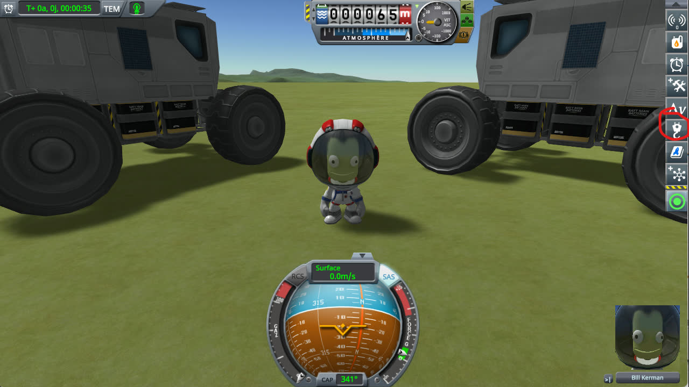
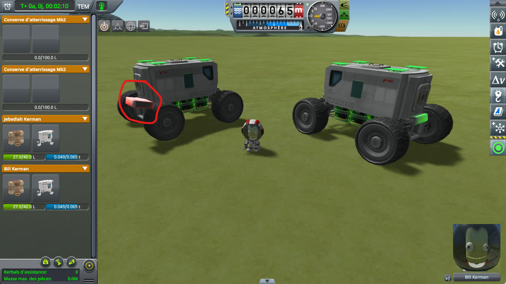
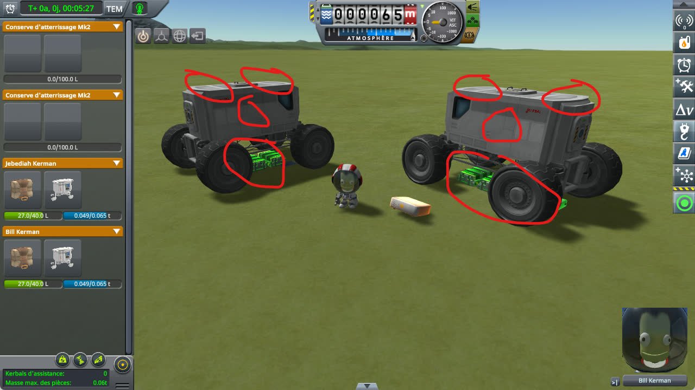

# Construction Physicsless Fix

**⚠️ Not finished yet.** This is a new fix, not a finished mod. The code and the conclusions on this page can still change.

A fix for stock KSP 1.12, kept as small as possible: two Harmony patches, in one source file. It is a mod of its own,
built on top of [KSP Community Fixes](https://github.com/KSPModdingLibs/KSPCommunityFixes), the base most players
run. Here is what it fixes:

> **In EVA construction mode, warping time with a part in hand makes the physicsless parts fall off.** The lights,
> batteries, small struts, antennas and other parts that have no physics of their own, on every vessel nearby, drop
> through their vessel to the ground when the warp ends, and stay there once the part is released. Reloading the game
> puts them back.

**How this was made.** The investigation and the code were written with Claude, Anthropic's AI
assistant. Everything here was reviewed and validated by a human — me. I am saying so up front, because
contributions made with an AI deserve a closer look than others, and because some people would rather
stop reading here. That look should be quick: the stock code involved is named and quoted on this page, and the fix
is one source file you can read in a few minutes.

## Why it matters

Building a base in EVA means holding parts for a long time, and warping time while a part is in hand, to wait for
daylight or for a kerbal to walk over, is a natural thing to do. The player gets no warning: the vessels look intact
during the warp, then their physicsless parts drop all at once. A part that has no physics of its own has no joint
either, so nothing holds it: a crane loses its lights and batteries, a rover parked nearby its ladders and solar
panels. If the game is saved then, the parts stay where they fell.

## The culprit

Two stock methods, harmless on their own:

- **`Part.OnCurrentMousePartChanged`** runs on every part in flight each time the held part changes. While the EVA
  construction panel is open with the Place tool, it gives each physicsless part (`PhysicalSignificance.NONE`) a
  `Rigidbody` of its own, kinematic, that ignores the collisions with its own vessel, and destroys it when nothing is
  held any more:

  ```csharp
  // Part.OnCurrentMousePartChanged (KSP 1.12), p being the part now held, or null
  if (p != null)
  {
      if (rb == null)
      {
          rb = base.gameObject.AddComponent<Rigidbody>();
          CollisionManager.SetCollidersOnVessel(vessel, ignore: true, GetPartColliders());
      }
      rb.isKinematic = true;
      ...
  }
  ```

- **`Part.Unpack`**, called on every part of a vessel when it comes off rails, at the end of a time warp or when it
  enters the physics range, turns its `Rigidbody` non-kinematic, whatever kind of part it is:

  ```csharp
  // Part.Unpack (KSP 1.12)
  if ((bool)rb && state != PartStates.DEAD)
  {
      rb.isKinematic = false;
      ...
  }
  ```

After a warp with a part in hand, each physicsless part is then a free body: `FlightIntegrator` applies gravity to
it, it has no joint, and it does not collide with its vessel. It falls through the vessel to the ground. Releasing the
part destroys the `Rigidbody`, and the part stays where it fell. Its saved position on the vessel is untouched, which
is why reloading repairs it.

**The same `Rigidbody` can outlive the panel.** `EVAConstructionModeController.ClosePanel` marks the panel closed
before it releases a detached part it could not drop, for instance one too heavy for the kerbals around it. The
handler above then returns early, and the physicsless parts keep their `Rigidbody`, and their collisions ignored with
their own vessel, until the game is reloaded: the next warp drops them, with nothing in hand.

## Checking the culprit

KSP 1.12.5 with [KSP Community Fixes](https://github.com/KSPModdingLibs/KSPCommunityFixes) 1.41.1. Copy
[construction-physicsless.sfs](diag/construction-physicsless.sfs) into the folder of a sandbox game and load it: Bill,
an engineer, is on EVA north of the runway, between two rovers. Each rover carries six Z-400 batteries under its frame
and six OX-STAT solar panels, all of them physicsless parts, and a ladder to climb aboard. Jebediah is aboard one of
them.



*The save loaded. The circled button opens the construction mode.*

Then, by hand:

1. Open the construction mode, and pick the Place tool.
2. Click the ladder of the left rover: Bill detaches it, and it follows the mouse.
3. Keep it in hand, and warp time at 5x for a few seconds.
4. Back to normal time.



*Step 2: the ladder of the left rover, circled, is held.*


*Step 3: time warps at 5x, the ladder in hand. Both rovers are still whole.*



*Step 4, on stock: back to normal time, a few seconds later. What changed is circled.*

- **On stock:** as soon as time is back to normal, the physicsless parts of both rovers fall: the batteries drop to
  the ground under the frame, and solar panels go missing from the roofs: they explode, with
  `solarPanels5 Exploded!!` in `KSP.log`. Releasing the ladder leaves everything where it fell.
- **With this mod:** nothing moves, nothing explodes; both rovers keep all their parts.

## The fix

Two patches, with their switches in [Settings](#settings), both on by default. Nothing is saved; removing the mod
gives the stock behaviour back at once.

- **`physicslessPartsStayStill`.** A prefix and a postfix of `Part.OnCurrentMousePartChanged` record each
  `Rigidbody` the stock handler has just added to a physicsless part, and forget it when the handler destroys it. A
  postfix of `Part.Unpack` turns a recorded `Rigidbody` back to kinematic. The parts then stay on their vessel through
  a warp, and the stock handler removes their `Rigidbody` as usual when the part is released.
- **`orphanRigidbodiesRemoved`.** When the held part is released with the panel already closed, the postfix does the
  clean-up the stock handler skipped: it destroys the recorded `Rigidbody` and restores the collisions with the
  vessel, as the stock handler does with the panel open.

A part made physical in the meantime is forgotten and left to the stock code. If a stock method is missing, nothing
is patched, with an error in `KSP.log`.

**Why record the `Rigidbody` instead of keeping every physicsless part's `Rigidbody` kinematic.** Some physicsless
parts own a `Rigidbody` on purpose: a wheel moved or rotated in EVA construction mode keeps its own, non-kinematic,
and a mod may give one to a part. Only what the stock handler created is touched.

**Why not test the panel and the held part in `Part.Unpack`.** That would miss the `Rigidbody` left behind when the
panel closes first: the panel is closed, nothing is held, and the parts still fall at the next warp.

## Work in progress

What a player would see if this mod broke something, or what it should fix but was not checked yet, and how to try
it by hand, with the mod and without:

- **A part taken from an inventory.** As in [Checking the culprit](#checking-the-culprit), but with a part picked
  from a kerbal's or a container's inventory instead of one detached from a vessel. On stock, the physicsless parts
  should fall the same way; with the mod, none should move, nor when the part is put back.
- **A panel closed with a detached part in hand.** Detach a part from a vessel with the Place tool, make it too heavy
  to drop (a kerbal who helped lift it walks away), and close the panel. Then warp time, with nothing in hand. On
  stock, the physicsless parts fall; with the mod, none moves. With `orphanRigidbodiesRemoved`, a physicsless part
  pushed against its own vessel should bump into it again, as before the construction mode was opened.
- **A vessel that comes within the physics range.** Pick a part with the Place tool far from a loaded vessel, then
  walk to it, part in hand, until it comes off rails. On stock, its physicsless parts should fall the same way; with
  the mod, none should move.
- **Wheels moved or rotated in EVA construction mode** should drive and brake as on stock.

## Install

Copy the `GameData\KSPFixConstructionPhysicsless` folder into the `GameData` folder of KSP. It needs
[Harmony](https://github.com/KSPModdingLibs/HarmonyKSP), as KSP Community Fixes does.

## Settings

`GameData\KSPFixConstructionPhysicsless\PluginData\settings.cfg` is read once, when KSP starts:

```
// Keeps the physicsless parts of a vessel in place when it comes off rails while a part is held.
physicslessPartsStayStill = True

// Also cleans up what the stock code leaves on them when the panel is closed with a part still held.
orphanRigidbodiesRemoved = True

// How much the mod writes to KSP.log: Error, Warning, Info or Debug.
logLevel = Info
```

- With `physicslessPartsStayStill = False`, nothing is patched: the parts fall as on stock.
- With `orphanRigidbodiesRemoved = False`, the parts left with a `Rigidbody` by a closed panel are still kept in
  place, but ignore the collisions with their own vessel until the game is reloaded, as on stock.
- At `Debug`, the mod writes one line per part kept kinematic each time its vessel comes off rails, and one per
  `Rigidbody` removed.

## Build

Set `KSPDIR` to the folder of a KSP install with Harmony in its `GameData`, then run `build.bat`: it
compiles `GameData\KSPFixConstructionPhysicsless\KSPFixConstructionPhysicsless.dll`. Installing is up to you.

## License

[MIT](LICENSE).
